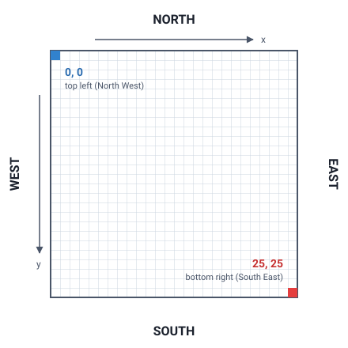

# light-vehikl-bot

A project to help you set up and run your own bot for the Light-Vehikl game.

Your bot only needs to implement one public function `decideMove`.

On each server event, the server will send out the state of the arena via a websocket.
This project has already been set up to receive that websocket event and pass the Arena
to your bot.

You can use the public functions and the data on the Arena object to decide which `Direction`
you want to move on the next turn. (See the Enum, values are NORTH, SOUTH, EAST, WEST).

0,0 is the top left of the grid (North West corner)
25, 25 is the bottom right of the grid (South East corner)

Starting position is determined by the order players or bots join the game.
Currently the possible starting positions are [0,0], [0,25], [25,0], [25,25]

You can check your location with $player->getLocation().

You can check if a tile is occupied calling $arena->getTile(x, y)->isOccupied().
Entering an occupied tile, or hitting the edge of the map will crash your vehikl.

In this version turns happen every 500 ms, and if you do not submit a move, your bot
continues in the same direction it was moving last turn.

You can connect your bot to a game that is waiting to start by using the following command:
> php lvbot play {gameId}

The game ID is visible on the game page.

CLI run using Laravel Zero.
Laravel Zero was created by [Nuno Maduro](https://github.com/nunomaduro) and [Owen Voke](https://github.com/owenvoke), and is a micro-framework that provides an elegant starting point for your console application. It is an **unofficial** and customized version of Laravel optimized for building command-line applications.
